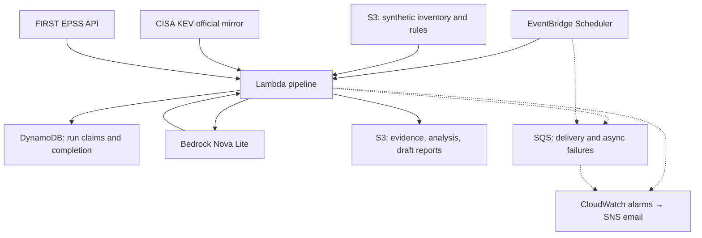

# AI Cyber Threat Intelligence Pipeline

An AWS portfolio pipeline that combines public vulnerability intelligence
with a fictional asset inventory to produce explainable review priorities
and AI-assisted draft reports.

## Purpose

Help an analyst answer:

- Which known-exploited vulnerabilities warrant review against this inventory?
- Why is each candidate prioritized?
- What evidence, timestamps, and uncertainties support the report?

The pipeline does not confirm vulnerability or compromise.
It does not scan external systems or automatically remediate assets.

## Architecture

## Processing

Collect → validate → normalize → assess synthetic applicability →
prioritize → summarize → render → record completion.

Raw source responses and processing artifacts are preserved in S3.
The pipeline records hashes, collection times, and source identifiers.

## Sources

- CISA Known Exploited Vulnerabilities catalog, using CISA's official
  GitHub mirror.
- FIRST Exploit Prediction Scoring System.

KEV listing concerns the vulnerability, not a specific asset.
EPSS estimates observed exploitation probability over the next 30 days;
it does not establish organizational compromise.

The EPSS API is used only for a small set of CVEs from the exercise rules.
This is not a bulk EPSS synchronization implementation.

## Synthetic applicability

Explicit exercise rules connect CVEs to inventory components.
Product-name similarity alone does not confirm a match.

Candidates remain needs_review.
Installed versions, configuration, and patch status require verification.
Assets without rule matches are not declared safe.

## Explainable prioritization

Policy: exercise-1.

| Signal | Points |
|---|---:|
| KEV-listed vulnerability | 50 |
| Internet-exposed asset | 25 |
| High business criticality | 15 |
| Medium business criticality | 10 |
| Available EPSS probability at least 0.50 | 10 |

Bands:
- 85–100: expedited review.
- 65–84: elevated review.
- Below 65: standard review.

These are exercise weights, not an industry risk standard.
Missing EPSS is explicit and is not converted to zero.

## AI analysis

Nova Lite receives source evidence and code-calculated priorities.
It returns commentary and source labels.

Code retains scores and applicability.
The application adds an uncertainty disclaimer.
Responses are checked for structure and permitted source labels.

These checks do not prove factual correctness.
A human must review reports before accepting or sharing them.

## Automation and operations

- Scheduled fresh-source processing.
- DynamoDB run claims and completed-input skipping.
- Source freshness thresholds.
- Per-attempt evidence and completion artifacts.
- Operational logs without document or report content.
- Lambda error and duration alarms.
- Failure queue and email notifications.

Committed schedule default: disabled.
A local configuration controls activation.

Repeat-run handling is not exactly-once execution.
A failure near completion can lead to additional processing.

## Tests

Run local evaluation:

    .\.venv\Scripts\python.exe -m app.evaluate_local

The suite covers validation, retries, normalization, applicability,
priorities, model-response structure, report handling, freshness,
and run tracking.

GitHub Actions runs the local evaluation on pushes and pull requests.
Live AWS processing and notifications are verified separately.

See the evaluation guide for the actual verified count and limitations.

## Project structure

- app/: collectors, processing, analysis, reporting, and AWS entry points.
- data/synthetic/: fictional inventory and review rules.
- data/raw/: ignored local source snapshots.
- data/processed/: ignored generated datasets.
- reports/: ignored generated reports and evaluation output.
- infra/terraform/: AWS infrastructure.
- tests/: local unit tests.
- docs/: design, operations, evaluations, and reviewed samples.

## Setup

Requires Python 3.13, AWS CLI, Terraform, and Git.

Local environment:

    python -m venv .venv
    .\.venv\Scripts\python.exe -m pip install -r requirements.txt

Local unit tests do not require AWS credentials.

AWS operations require a configured portfolio-sandbox SSO profile:

    aws sso login --profile portfolio-sandbox

This repository currently contains environment-specific account IDs
and resource names. Adapt them before deploying elsewhere.

## Documentation

- [Collection](docs/collection.md)
- [EPSS](docs/epss.md)
- [Normalization](docs/normalization.md)
- [Asset applicability](docs/asset-applicability.md)
- [Prioritization](docs/prioritization.md)
- [Automation](docs/automation.md)
- [Evaluation](docs/evaluation.md)
- [Operations](docs/operations.md)
- [Demo](docs/demo.md)
- [Reviewed synthetic report](docs/samples/reviewed-report.md)

## Limitations

- Three candidate assessments per scheduled sandbox run.
- Explicit synthetic review rules rather than comprehensive applicability.
- No scanning, affected-version discovery, or patch verification.
- AI commentary can contain incorrect attribution or wording.
- No Project 2 Bedrock Guardrail is configured.
- No comprehensive semantic evaluator or load test.
- No absent-run heartbeat alarm.
- No production compliance or security certification.
- Terraform state remains local and requires protected backups.

## Costs and cleanup

AWS resources are metered. Budget alerts do not cap spending.
Disable the schedule when it is not needed.

Review a Terraform destroy plan before cleanup.
Versioned S3 objects can prevent bucket deletion.
Preserve state and required evidence before removing infrastructure.

Project 1 uses a separate repository and configuration.